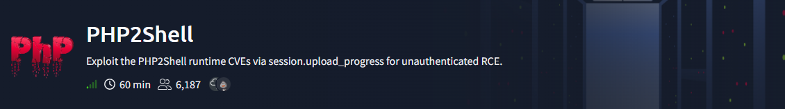
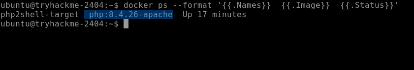
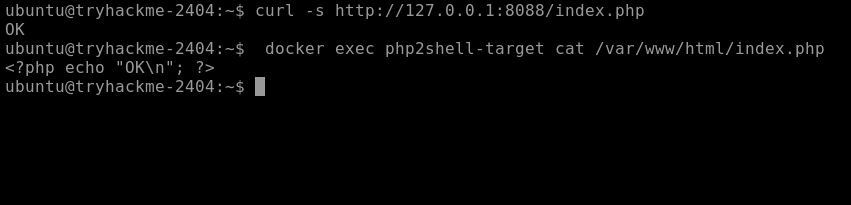
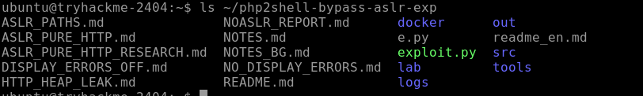
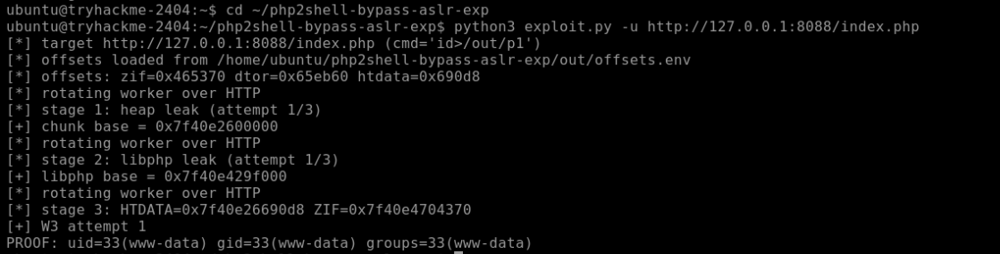
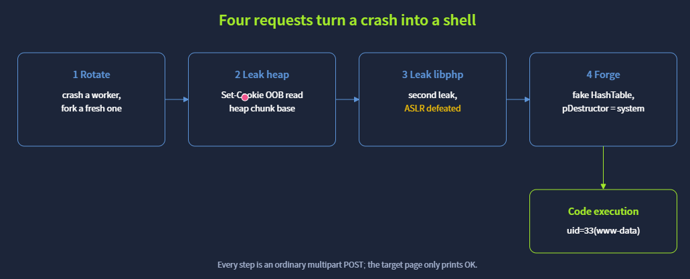
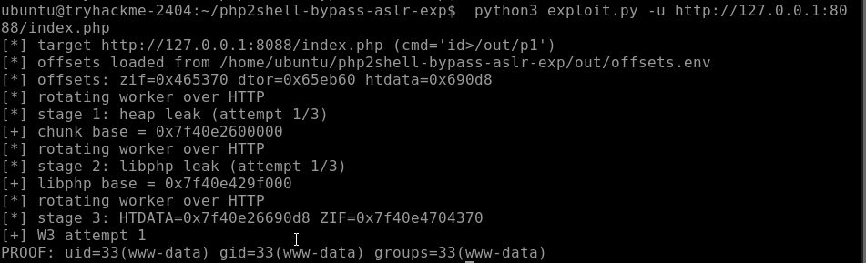
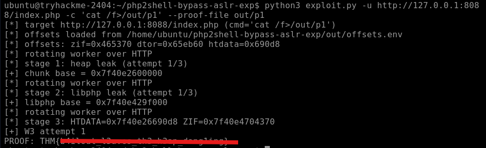
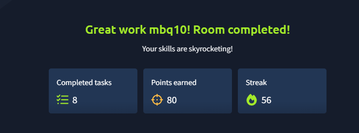

# PHP2Shell — TryHackMe Walkthrough

[](https://tryhackme.com/room/cvephp2shell)
[](https://tryhackme.com/room/cvephp2shell)
[]()
[]()



A walkthrough of the **PHP2Shell** room on TryHackMe — a real-world PHP runtime vulnerability chain (CVE-2026-109618 + CVE-2026-109619) that achieves **Remote Code Execution against a page whose only code is `echo "OK";`**. No application bug, no upload form, no SQL — just a corrupted pointer in the PHP engine itself.

**Room:** https://tryhackme.com/room/cvephp2shell

---

## Understanding the Vulnerability Chain

Before touching a single command, it helps to understand *how* the two CVEs connect and why each step is necessary.

### The Root Cause — A Feature Gone Wrong

PHP has a feature called **`session.upload_progress`**: when a browser uploads a file via `multipart/form-data`, PHP stores progress information (filename, bytes received, etc.) in the user's session — accessible via the special form field `PHP_SESSION_UPLOAD_PROGRESS`.

This feature runs **during request body parsing**, before the target PHP script even executes. That matters enormously: the attack works even without any application-level upload page, authentication bypass, or application bug.

### The Bug — Dangling Pointer After Memory Bailout

When PHP runs out of memory (`memory_limit` is hit), it performs an emergency abort using `longjmp()`. PHP calls this a **Bailout**.

Unlike a normal exit, a bailout can **skip cleanup code**. In this case it frees a block of memory but leaves behind a **dangling pointer** — a pointer that still points to memory that has been freed and could be overwritten by a later allocation.

This is classified as **CWE-824: Access of Uninitialized Pointer**.

### Why Apache Worker Reuse Matters

Apache `prefork` + `mod_php` means one worker process handles many requests sequentially. If a failed request leaves a dangling pointer behind in the worker, **the next request handled by the same process inherits that stale state**. This is what makes the vulnerability exploitable — a second request can trigger the corrupted pointer while it is still alive.

### The Two CVEs

| CVE | Type | What it does |
|-----|------|--------------|
| CVE-2026-109618 | Memory Disclosure | Leaks process memory through the `Set-Cookie: PHPSESSID` response header — used to defeat ASLR |
| CVE-2026-109619 | Remote Code Execution | Forges an internal PHP `HashTable` whose `pDestructor` pointer is redirected to `system()`, executing attacker-supplied commands during cleanup |

The two chain together: **leak first** to get real memory addresses (defeating ASLR), then **forge** a structure at a known address to hijack execution.

---

## Task 4 — Reconnaissance: Confirming the Target

Everything runs on `127.0.0.1:8088` inside the TryHackMe machine. First, confirm what PHP version the vulnerable container is running.

### Command 1 — List running Docker containers

```bash
docker ps --format '{{.Names}}  {{.Image}}  {{.Status}}'
```

**Why this command:**
`docker ps` lists running containers. The `--format` flag uses Go template syntax to print only the fields we care about — container name, image, and status — instead of a wide table. This quickly confirms whether the `php2shell-target` container is up and what image it uses (which encodes the PHP version).



The PHP version is **8.4.26** — confirmed vulnerable. The patched version is 8.4.27, so anything below that is in range.

### Command 2 — Read the target application code

```bash
curl -s http://127.0.0.1:8088/index.php
docker exec php2shell-target cat /var/www/html/index.php
```

**Why these commands:**

`curl -s` (`-s` = silent, suppresses progress output) fetches the page response. The output is just `OK`.

`docker exec` runs a command **inside** the container without a shell session — here it reads the actual PHP source of the page being attacked. The result is the entire application: one line, `echo "OK"`.

This is the most important point of the room: **there is no vulnerability in the application code**. The exploit targets the PHP runtime beneath it.



### Command 3 — Locate the exploit

```bash
ls ~/php2shell-bypass-aslr-exp
```

**Why:** Confirms the pre-placed exploit directory exists and shows what files it contains before running anything.



---

## Task 5 — Leaking Memory and Defeating ASLR (CVE-2026-109618)

### What is ASLR?

**Address Space Layout Randomization** randomises where the OS places key regions (heap, stack, libraries) in a process's memory each time it starts. An exploit that needs to call a specific function (like `system()`) must know where that function lives in memory — ASLR makes guessing impossible across reboots. The leak phase solves this.

### How CVE-2026-109618 Works (Step by Step)

1. A crafted `multipart/form-data` request triggers an out-of-memory bailout during session progress parsing.
2. The bailout frees session memory but leaves a dangling pointer that still references the freed block.
3. A second request causes different data to be allocated at (or near) the freed location, partially overwriting it.
4. The stale pointer now reads what looks like a session ID string, but the **length field is corrupt** — it is larger than the real string.
5. When PHP generates the `Set-Cookie: PHPSESSID` response header, it copies the session ID using the corrupt length, reading **beyond the string boundary into adjacent process memory**.
6. That adjacent memory — containing heap addresses and library addresses — is returned to the attacker in the HTTP response header.

Two leaks are extracted:

- **Heap leak:** the base address of the heap region in this worker.
- **libphp leak:** the base address of the loaded PHP runtime library (`libphp.so`).

With these two addresses known, ASLR is effectively defeated for this worker process.

### Command 4 — Run the exploit (leak + RCE chain)

```bash
cd ~/php2shell-bypass-aslr-exp
python3 exploit.py -u http://127.0.0.1:8088/index.php
```

**Why this command:**

`-u` supplies the target URL — the page whose PHP runtime will be exploited. Running the script with no `-c` argument triggers the full chain (leak → forge → execute) with a default proof command (`id`) to confirm RCE. The script outputs the two leaked addresses, then the result of `id`.



---

## Task 6 — From a Leak to a Shell (CVE-2026-109619)

### How CVE-2026-109619 Works (Step by Step)

1. The leaked heap and libphp addresses give the exploit exact knowledge of memory layout in the current Apache worker.
2. The exploit crafts a **forged PHP `HashTable`** structure — an internal PHP data type used to represent arrays and object property tables — and writes it into a predictable heap location revealed by the previous leak.
3. Inside the forged `HashTable`, the **`pDestructor`** function pointer (normally called when the table is freed) is set to the real address of PHP's internal `system()` wrapper — calculable from the libphp base address.
4. A key in the forged table is set to the attacker's command string.
5. The exploit triggers the forged table's cleanup path; PHP calls `pDestructor` (now pointing to `system()`) with the key as its argument — executing the command as the web server user (`www-data`).



### Command 5 — Confirm RCE with `id`

```bash
python3 exploit.py -u http://127.0.0.1:8088/index.php
```

Running without `-c` defaults to running `id` — a harmless command that returns the current user and groups. Seeing `uid=33(www-data)` in the output proves the command executed on the server.



### Command 6 — Read the Flag

```bash
python3 exploit.py -u http://127.0.0.1:8088/index.php -c 'cat /f>/out/p1' --proof-file out/p1
```

**Why every part of this command:**

| Part | Explanation |
|------|-------------|
| `-c 'cat /f>/out/p1'` | `-c` supplies the command to execute on the server. The flag lives at `/f` (a deliberately short path — the exploit's payload space for the command is only 14 bytes). `>out/p1` redirects the flag into a file in the shared `out/` directory that both the container and the host can reach. |
| `--proof-file out/p1` | Tells the exploit script where to look for the output file and print its contents back to the terminal after the command runs. |

The entire chain — two memory leaks, ASLR bypass, forged structure, function pointer hijack, command execution — completes in **under ten seconds**.



---

## Task 7 — Detection, Mitigation & The Real Fix

### Permanent Fix

Because the bug is in the **PHP runtime**, updating the application (WordPress, Laravel, Drupal, etc.) does nothing. The fix is a PHP update:

| Branch | Patched version |
|--------|-----------------|
| PHP 8.5 | 8.5.12 |
| PHP 8.4 | **8.4.27** |
| PHP 8.3 | 8.3.36 |
| PHP 8.2 | 8.2.35 |

Restart Apache/PHP-FPM after updating so workers load the patched code.

### Temporary Mitigations

| `php.ini` directive | Effect |
|---------------------|--------|
| `session.upload_progress.enabled = 0` | Disables the feature that triggers the vulnerable code path — the most direct mitigation |
| `opcache.enable = 0` | Can frustrate the code-execution path |
| `fatal_error_backtraces = 0` | Addresses CVE-2026-109619 specifically on PHP 8.5 |
| Block `multipart/form-data` at the WAF/proxy | Blocks the delivery mechanism — may break legitimate file uploads |
| Least-privilege web user | Limits blast radius if exploitation succeeds |

> **Important:** A WAF implemented as a PHP module may not work — the attack happens during *request parsing*, before the module runs. Protection must sit in front of PHP (a reverse proxy, network firewall, or patched runtime).

### Detection Indicators

Watch for:

- Unusually large `PHPSESSID` values in `Set-Cookie` response headers.
- Large `multipart/form-data` POST bodies with abnormally high field counts.
- Requests containing the `PHP_SESSION_UPLOAD_PROGRESS` field on pages that don't implement upload forms.
- PHP worker crashes or out-of-memory entries in server logs.

---



## Full Attack Chain Summary

```
1. Craft multipart request → trigger OOM bailout → dangling pointer created
                                    │
2. Send follow-up request → stale pointer reads adjacent heap memory
                                    │
3. PHP copies oversized PHPSESSID into Set-Cookie header → memory disclosed
                                    │
4. Parse leaked header → extract heap base + libphp base → ASLR defeated
                                    │
5. Calculate system() address from libphp base
                                    │
6. Write forged HashTable to known heap address
   └── pDestructor → system()
   └── key → attacker command
                                    │
7. Trigger cleanup → pDestructor called → command executes as www-data
```

## Skills Demonstrated

| Area | Skill |
|------|-------|
| Vulnerability research | Understanding CVEs at the source-code level (dangling pointers, bailout paths) |
| Memory exploitation | ASLR bypass via memory-disclosure side channel |
| PHP internals | HashTable structure, `pDestructor` function pointer abuse |
| Exploit execution | Running a multi-stage exploit and interpreting its output |
| Defence | Identifying patched versions, temporary mitigations, and detection indicators |

---

## Disclaimer

This walkthrough documents work performed on a deliberately vulnerable TryHackMe lab machine for educational purposes only. The CVE numbers used in this room are fictional lab identifiers, not real NVD entries. None of the techniques here should be applied against systems you do not own or have explicit written permission to test.
